<div align="center">

<a href="https://github.com/Adelkazzaz">
  
</a>

<br />

```text
┌──────────────────────────────────────────────────────────────────────────┐
│  adel@github:~$ whoami                                                   │
│  Adel Kazzaz — ML Systems, MLOps, and real-time computer vision           │
│                                                                          │
│  adel@github:~$ status --focus                                            │
│  [online] model serving  [online] observability  [online] deployment     │
└──────────────────────────────────────────────────────────────────────────┘
```


<a href="https://www.linkedin.com/in/adelkazzaz"></a>
<a href="https://kaggle.com/adelkazzaz"></a>
<a href="https://leetcode.com/u/AdelKazzaz/"></a>
<a href="https://codeforces.com/profile/adelkazzaz"></a>
<a href="mailto:contact.kazzaz@gmail.com"></a>

</div>

<br />

## `>_` About me

I build the systems around machine learning: preparing data, training and evaluating models, optimizing runtimes, packaging inference services, and making deployments observable.

My sweet spot is **ML Systems, MLOps, and real-time computer vision**. I care about measurable throughput, reproducible experiments, clean interfaces, and the engineering trade-offs that turn a promising model into a dependable product.

```text
focus/
├── model serving & inference optimization
├── computer vision & real-time pipelines
├── containers, APIs & cloud deployment
└── CI/CD, monitoring & reproducible experiments
```

## `./featured-work.sh`

<table>
<tr>
<td width="50%" valign="top">

### 🚗 Real-Time Object Detection

End-to-end computer vision pipeline built with **YOLOv11n** on KITTI and deployed on Azure.

`92.4% mAP` · `196 FPS` · `5.1 ms latency`

ONNX/TorchScript export, inference optimization, API serving, and pipeline monitoring.

<a href="https://github.com/Adelkazzaz">View project →</a>

</td>
<td width="50%" valign="top">

### ☁️ Easy Deploy

Automated platform for shipping GitHub repositories directly to AWS infrastructure.

Infrastructure automation, CI/CD orchestration, and cloud resource management designed to reduce configuration overhead.

<a href="https://github.com/Adelkazzaz">View project →</a>

</td>
</tr>
<tr>
<td width="50%" valign="top">

### 🧠 MiniRag

Production-oriented RAG service for low-latency document question answering.

FastAPI · LangChain · Qdrant · MongoDB · Docker

<a href="https://github.com/Adelkazzaz/MiniRag">View repository →</a>

</td>
<td width="50%" valign="top">

### 🎥 Linucast

Linux virtual camera application with real-time AI face tracking, auto-framing, and background segmentation.

Native, low-overhead video inference for Linux desktop pipelines.

<a href="https://github.com/Adelkazzaz/Linucast">View repository →</a>

</td>
</tr>
</table>

## `stack --list`



<div align="center">

`Python` · `C++` · `Go` · `C#` · `Bash`<br />
`PyTorch` · `TensorFlow` · `ONNX` · `FastAPI`<br />
`Docker` · `Kubernetes` · `AWS` · `Azure` · `Linux`<br />
`MongoDB` · `MySQL` · `Git` · `GitHub Actions`

</div>

## `metrics --live`

<div align="center">


<br />


</div>

<details>
<summary><b>Animated contribution graph</b></summary>
<br />

<div align="center">

<picture>
  <source media="(prefers-color-scheme: dark)" srcset="https://raw.githubusercontent.com/Adelkazzaz/Adelkazzaz/output/github-contribution-grid-snake-dark.svg">
  <source media="(prefers-color-scheme: light)" srcset="https://raw.githubusercontent.com/Adelkazzaz/Adelkazzaz/output/github-contribution-grid-snake.svg">
  
</picture>

</div>
</details>

<div align="center">

<br />

<a href="mailto:contact.kazzaz@gmail.com">Let’s build something reliable.</a>

<br /><br />


</div>
