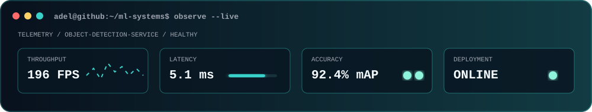
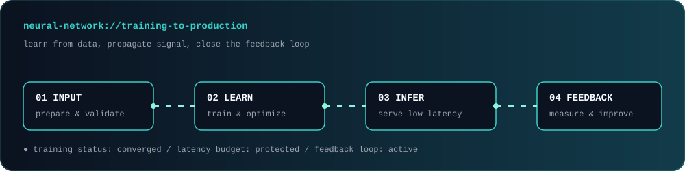

<div align="center">

<a href="https://github.com/Adelkazzaz" target="_blank" rel="noopener noreferrer">
  
</a>

<a href="https://www.linkedin.com/in/adelkazzaz" target="_blank" rel="noopener noreferrer"></a>
<a href="https://kaggle.com/adelkazzaz" target="_blank" rel="noopener noreferrer"></a>
<a href="https://leetcode.com/u/AdelKazzaz/" target="_blank" rel="noopener noreferrer"></a>
<a href="https://codeforces.com/profile/adelkazzaz" target="_blank" rel="noopener noreferrer"></a>
<a href="mailto:contact.kazzaz@gmail.com" target="_blank" rel="noopener noreferrer"></a>

</div>

<br />

## `$ cat /etc/adel/about`

I build the systems around machine learning: preparing data, training and evaluating models, optimizing runtimes, packaging inference services, and making deployments observable.

My sweet spot is **ML Systems, MLOps, and real-time computer vision**. I care about measurable throughput, reproducible experiments, clean interfaces, and the engineering trade-offs that turn a promising model into a dependable product.

```text
focus/
├── model serving & inference optimization
├── computer vision & real-time pipelines
├── containers, APIs & cloud deployment
└── CI/CD, monitoring & reproducible experiments
```

```console
adel@github:~/featured-work$ ls -1 --color=always
real-time-object-detection  easy-deploy  MiniRag  Linucast
```

<div align="center">

<a href="https://github.com/Adelkazzaz" target="_blank" rel="noopener noreferrer">[ open: real-time-object-detection ↗ ]</a> ·
<a href="https://github.com/Adelkazzaz" target="_blank" rel="noopener noreferrer">[ open: easy-deploy ↗ ]</a> ·
<a href="https://github.com/Adelkazzaz/MiniRag" target="_blank" rel="noopener noreferrer">[ open: MiniRag ↗ ]</a> ·
<a href="https://github.com/Adelkazzaz/Linucast" target="_blank" rel="noopener noreferrer">[ open: Linucast ↗ ]</a>

</div>

## `$ stack --list --color=teal`


<div align="center">

`Python` · `C++` · `Go` · `C#` · `Bash`<br />
`PyTorch` · `TensorFlow` · `ONNX` · `FastAPI`<br />
`Docker` · `Kubernetes` · `AWS` · `Azure` · `Linux`<br />
`MongoDB` · `MySQL` · `Git` · `GitHub Actions`

</div>

## `$ observe --live`



<div align="center">


<br />


</div>

<details>
<summary><b>$ git log --graph --animate</b></summary>
<br />

<div align="center">

<picture>
  <source media="(prefers-color-scheme: dark)" srcset="https://raw.githubusercontent.com/Adelkazzaz/Adelkazzaz/output/github-contribution-grid-snake-dark.svg">
  <source media="(prefers-color-scheme: light)" srcset="https://raw.githubusercontent.com/Adelkazzaz/Adelkazzaz/output/github-contribution-grid-snake.svg">
  
</picture>

</div>
</details>

<div align="center">

<br />

<a href="mailto:contact.kazzaz@gmail.com" target="_blank" rel="noopener noreferrer">$ printf "Let’s build something reliable.\n" ↗</a>

<br /><br />

<a href="https://github.com/Adelkazzaz" target="_blank" rel="noopener noreferrer">
  
</a>

</div>
