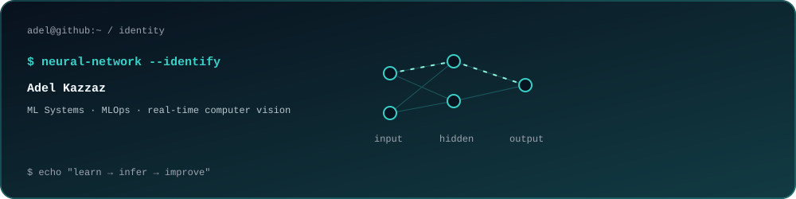

<div align="center">

<a href="https://github.com/Adelkazzaz">
  
</a>

<br />

<a href="https://github.com/Adelkazzaz">
  
</a>


<a href="https://www.linkedin.com/in/adelkazzaz"></a>
<a href="https://kaggle.com/adelkazzaz"></a>
<a href="https://leetcode.com/u/AdelKazzaz/"></a>
<a href="https://codeforces.com/profile/adelkazzaz"></a>
<a href="mailto:contact.kazzaz@gmail.com"></a>

</div>

<br />

## `$ cat /etc/adel/about`

I build the systems around machine learning: preparing data, training and evaluating models, optimizing runtimes, packaging inference services, and making deployments observable.

My sweet spot is **ML Systems, MLOps, and real-time computer vision**. I care about measurable throughput, reproducible experiments, clean interfaces, and the engineering trade-offs that turn a promising model into a dependable product.

```text
focus/
├── model serving & inference optimization
├── computer vision & real-time pipelines
├── containers, APIs & cloud deployment
└── CI/CD, monitoring & reproducible experiments
```

## `$ ./featured-work.sh --verbose`

```text
┌─[01] real-time-object-detection────────────────────────────────────────────
│ YOLOv11n · KITTI · Azure                                                 
│ 92.4% mAP  ·  196 FPS  ·  5.1 ms latency                                
│ ONNX/TorchScript export · API serving · pipeline monitoring             
└─> github.com/Adelkazzaz                                                

┌─[02] easy-deploy───────────────────────────────────────────────────────────
│ GitHub → AWS automation · infrastructure provisioning · CI/CD orchestration
│ Reduced developer cloud configuration overhead by 40%                      
└─> github.com/Adelkazzaz                                                    

┌─[03] minirag───────────────────────────────────────────────────────────────
│ Low-latency document Q&A · FastAPI · LangChain · Qdrant · MongoDB · Docker 
└─> github.com/Adelkazzaz/MiniRag                                            

┌─[04] linucast──────────────────────────────────────────────────────────────
│ Linux virtual camera · face tracking · auto-framing · segmentation         
└─> github.com/Adelkazzaz/Linucast                                           
```

`[open: real-time-object-detection](https://github.com/Adelkazzaz)` ·
`[open: easy-deploy](https://github.com/Adelkazzaz)` ·
`[open: minirag](https://github.com/Adelkazzaz/MiniRag)` ·
`[open: linucast](https://github.com/Adelkazzaz/Linucast)`

## `$ stack --list --color=teal`


<div align="center">

`Python` · `C++` · `Go` · `C#` · `Bash`<br />
`PyTorch` · `TensorFlow` · `ONNX` · `FastAPI`<br />
`Docker` · `Kubernetes` · `AWS` · `Azure` · `Linux`<br />
`MongoDB` · `MySQL` · `Git` · `GitHub Actions`

</div>

## `$ observe --live`


<div align="center">


<br />


</div>

<details>
<summary><b>$ git log --graph --animate</b></summary>
<br />

<div align="center">

<picture>
  <source media="(prefers-color-scheme: dark)" srcset="https://raw.githubusercontent.com/Adelkazzaz/Adelkazzaz/output/github-contribution-grid-snake-dark.svg">
  <source media="(prefers-color-scheme: light)" srcset="https://raw.githubusercontent.com/Adelkazzaz/Adelkazzaz/output/github-contribution-grid-snake.svg">
  
</picture>

</div>
</details>

<div align="center">

<br />

<a href="mailto:contact.kazzaz@gmail.com">$ printf "Let’s build something reliable.\n"</a>

<br /><br />


</div>
